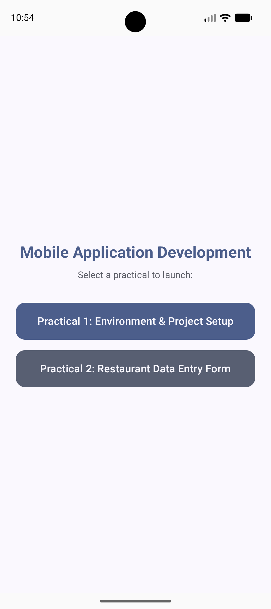
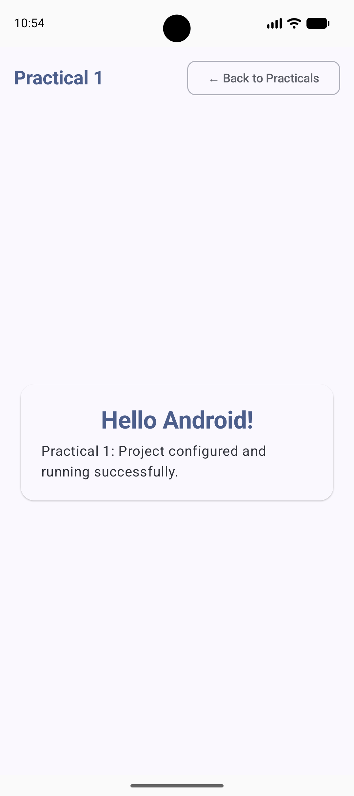

# Practical 1 (Session 2): Project Anatomy, Kotlin Tour, Code Deep Dive & App Execution

> **Course:** Mobile Application Development  
> **Part:** Practical 1 — Session 2

---

## 🎯 Session 2 Objectives

- Master the Android project directory structure and file flow.
- Understand the architecture, components, and tags of `AndroidManifest.xml`.
- Study Kotlin language fundamentals using the official Kotlin Beginner Tour.
- Explore and modify Jetpack Compose UI code in `MainActivity.kt`.
- Build a practicals dashboard menu with buttons for Practical 1 and Practical 2 opening pages with simple text.
- Build, deploy, and verify the live personalized app on the running emulator.

---

## 📂 Section 1: Understanding Project Anatomy & File Flow

Switch your Project view in Android Studio to **Android** mode. Your project is organized into two primary root trees: **app** and **Gradle Scripts**.

```
p1/
├── app/
│   ├── manifests/
│   │   └── AndroidManifest.xml        <-- Application blueprint & permissions
│   ├── kotlin+java/
│   │   └── com.example.p1/
│   │       ├── MainActivity.kt        <-- Main UI & Activity lifecycle
│   │       └── ui/theme/              <-- Material 3 styling tokens
│   │           ├── Color.kt           <-- Color definitions
│   │           ├── Theme.kt           <-- Light/Dark color schemes
│   │           └── Type.kt            <-- Typography & font styles
│   └── res/                           <-- Static application resources
│       ├── drawable/                  <-- Vector assets & graphics
│       ├── mipmap/                    <-- App launcher icons (density-scaled)
│       ├── values/                    <-- strings.xml, colors.xml
│       └── xml/                       <-- Backup & data extraction rules
└── Gradle Scripts/
    ├── build.gradle.kts (Project: p1) <-- Top-level build configuration
    ├── build.gradle.kts (Module :app) <-- Module dependencies, SDKs, plugins
    ├── settings.gradle.kts            <-- Repositories & module inclusions
    └── gradle.properties              <-- JVM memory & AndroidX settings
```

### 1.1 What Does Each Directory Do?
* **`manifests/`:** Houses `AndroidManifest.xml` which defines core app characteristics to the operating system.
* **`kotlin+java/`:** Contains your Kotlin source code organized by package names (`com.example.p1`).
* **`res/drawable/`:** Contains XML-based vector graphics and static bitmap images.
* **`res/mipmap/`:** Stores application launcher icons in multiple screen density formats (`mdpi`, `hdpi`, `xhdpi`, `xxhdpi`, `xxxhdpi`) so the OS can pick the crispest icon.
* **`res/values/strings.xml`:** Key-value string resources allowing easy text management and multi-language internationalization.
* **`Gradle Scripts/`:** All automated build logic, library dependency declarations, and SDK targeting rules.

---

## 📜 Section 2: Deep Dive into `AndroidManifest.xml` & Build Scripts

### 2.1 `AndroidManifest.xml` Walkthrough
The `AndroidManifest.xml` file is the fundamental contract between your app and the Android OS.

**Reference File:** [`p1/app/src/main/AndroidManifest.xml`](./p1/app/src/main/AndroidManifest.xml)

```xml
<?xml version="1.0" encoding="utf-8"?>
<manifest xmlns:android="http://schemas.android.com/apk/res/android"
    xmlns:tools="http://schemas.android.com/tools">

    <application
        android:allowBackup="true"
        android:dataExtractionRules="@xml/data_extraction_rules"
        android:fullBackupContent="@xml/backup_rules"
        android:icon="@mipmap/ic_launcher"
        android:label="@string/app_name"
        android:roundIcon="@mipmap/ic_launcher_round"
        android:supportsRtl="true"
        android:theme="@style/Theme.P1">
        
        <!-- Activity Declaration -->
        <activity
            android:name=".MainActivity"
            android:exported="true"
            android:label="@string/app_name"
            android:theme="@style/Theme.P1"
            android:windowSoftInputMode="adjustResize">
            
            <!-- Intent Filter: Declares App Entry Point -->
            <intent-filter>
                <action android:name="android.intent.action.MAIN" />
                <category android:name="android.intent.category.LAUNCHER" />
            </intent-filter>
        </activity>
    </application>
</manifest>
```

#### Breakdown of Critical Tags:
1. **`<manifest>`:** Root element defining XML namespaces (`xmlns:android`) and configuration attributes.
2. **`<application>`:** Encloses global application settings:
   - `android:icon` & `android:roundIcon`: References the launcher icon in `res/mipmap/`.
   - `android:label`: The application name read from `@string/app_name`.
   - `android:supportsRtl="true"`: Enables Right-to-Left layout mirroring.
3. **`<activity>`:** Registers every screen in your app with the OS.
   - `android:name=".MainActivity"`: Specifies the Kotlin class implementing the activity.
   - `android:exported="true"`: Mandatory for launcher activities; allows the Android OS launcher to start this activity.
4. **`<intent-filter>`:** Tells the Android system how this activity should be triggered:
   - `<action android:name="android.intent.action.MAIN" />`: Designates this activity as the primary entry point.
   - `<category android:name="android.intent.category.LAUNCHER" />`: Places the app's launch icon inside the device's application drawer.

---

### 2.2 Gradle Build Configuration: `build.gradle.kts`
**Reference File:** [`p1/app/build.gradle.kts`](./p1/app/build.gradle.kts)

Key blocks every student should understand:
* **`compileSdk = 34` (or 35):** The Android API version against which the Kotlin compiler compiles your code.
* **`minSdk = 24` (or 33):** The minimum device OS level capable of executing the APK.
* **`targetSdk = 34` (or 35):** Indicates your app has been verified against this API level's behavioral rules.
* **`dependencies { ... }`:** Declares libraries (Jetpack Compose BOM, Material 3, Activity-Compose, JUnit).

---

## 📖 Section 3: Kotlin Beginner Tour & Core Fundamentals

Android is built using Kotlin. All students should explore the official **Kotlin Beginner Tour**:

> 🔗 **Official Resource:** [Kotlin Tour Welcome & Tutorial](https://kotlinlang.org/docs/kotlin-tour-welcome.html)  
> *Source: JetBrains & The Kotlin Foundation*

### Essential Concepts Every Student Must Master:

#### 1. Variables (`val` vs `var`)
```kotlin
val courseName: String = "Mobile Application Development" // Immutable (read-only, cannot be changed)
var labProgress: Int = 1                                  // Mutable (can be reassigned)
```

#### 2. Type Inference
Kotlin can automatically infer types without explicit declarations:
```kotlin
val greeting = "Welcome to Session 2" // Inferred as String
val practicalNumber = 1               // Inferred as Int
```

#### 3. Null Safety (Eliminating NullPointerExceptions)
```kotlin
var nonNullable: String = "Android"  // Cannot be null
// nonNullable = null                // Compilation Error!

var nullable: String? = "Android"   // Nullable type
nullable = null                     // Allowed

// Safe call (?.) and Elvis operator (?:)
val length: Int = nullable?.length ?: 0
```

#### 4. Functions & Default Arguments
```kotlin
fun buildGreeting(name: String, prefix: String = "Hello"): String {
    return "$prefix, $name!"
}
```

#### 5. Lambdas & Trailing Lambda Syntax
In Kotlin, if the final parameter of a function is a lambda function, you can write it outside the parentheses. Jetpack Compose utilizes this syntax everywhere:
```kotlin
// setContent(content = { ... }) becomes:
setContent {
    P1Theme {
        Greeting("Android")
    }
}
```

---

## 💻 Section 4: Jetpack Compose Code Walkthrough (`MainActivity.kt`)

Open [`p1/app/src/main/java/com/example/p1/MainActivity.kt`](./p1/app/src/main/java/com/example/p1/MainActivity.kt) to examine the declarative UI structure:

```kotlin
package com.example.p1

import android.os.Bundle
import androidx.activity.ComponentActivity
import androidx.activity.compose.setContent
import androidx.activity.enableEdgeToEdge
import androidx.compose.foundation.layout.fillMaxSize
import androidx.compose.foundation.layout.padding
import androidx.compose.material3.Scaffold
import androidx.compose.material3.Text
import androidx.compose.runtime.Composable
import androidx.compose.ui.Modifier
import androidx.compose.ui.tooling.preview.Preview
import com.example.p1.ui.theme.P1Theme

class MainActivity : ComponentActivity() {
    override fun onCreate(savedInstanceState: Bundle?) {
        super.onCreate(savedInstanceState)
        enableEdgeToEdge()
        setContent {
            P1Theme {
                Scaffold(modifier = Modifier.fillMaxSize()) { innerPadding ->
                    Greeting(
                        name = "Android",
                        modifier = Modifier.padding(innerPadding)
                    )
                }
            }
        }
    }
}

@Composable
fun Greeting(name: String, modifier: Modifier = Modifier) {
    Text(
        text = "Hello $name!",
        modifier = modifier
    )
}

@Preview(showBackground = true)
@Composable
fun GreetingPreview() {
    P1Theme {
        Greeting("Android")
    }
}
```

### Step-by-Step Code Flow:
1. `MainActivity` inherits from `ComponentActivity`, providing lifecycle integration.
2. `onCreate()` is invoked when the OS initializes the activity.
3. `enableEdgeToEdge()` ensures the UI renders edge-to-edge across the screen.
4. `setContent { ... }` initializes Jetpack Compose without XML layouts.
5. `@Composable fun Greeting()` is a declarative function describing UI state as a Material 3 `Text` element.
6. `@Preview` enables instant visual UI previews directly inside Android Studio without booting the emulator.

---

### 4.2 Building a Practicals Dashboard Menu with Buttons

To prepare your project for subsequent lab practicals, we structure `MainActivity.kt` with a **Dashboard Menu** containing buttons for **Practical 1** and **Practical 2**. Each button opens a dedicated page displaying simple text, with a header button to return to the menu.

#### 1. Preventing Top Bar Overlap with `safeDrawingPadding()`
Because `enableEdgeToEdge()` is active, Android draws content behind the system status bar (where the clock, battery, and camera notch sit). We apply **`Modifier.safeDrawingPadding()`** to the root `Surface` so the top header and back button are never covered by the phone's top bar:

```kotlin
Surface(
    modifier = Modifier
        .fillMaxSize()
        .safeDrawingPadding(), // Automatically insets below the phone's status bar
    color = MaterialTheme.colorScheme.background
) {
    // Screen contents
}
```

#### 2. Screen Navigation State & Buttons
We declare an enum to represent the active screen:

```kotlin
enum class ActiveScreen {
    HOME,
    PRACTICAL_1,
    PRACTICAL_2
}
```

Inside `MainActivity`, a state variable `currentScreen` tracks which screen to show:

```kotlin
var currentScreen by remember { mutableStateOf(ActiveScreen.HOME) }

// Hardware / gesture back button returns to the Home menu
BackHandler(enabled = currentScreen != ActiveScreen.HOME) {
    currentScreen = ActiveScreen.HOME
}

when (currentScreen) {
    ActiveScreen.HOME -> {
        PracticalsMenuScreen(
            onSelectPractical1 = { currentScreen = ActiveScreen.PRACTICAL_1 },
            onSelectPractical2 = { currentScreen = ActiveScreen.PRACTICAL_2 }
        )
    }
    ActiveScreen.PRACTICAL_1 -> {
        Column(modifier = Modifier.fillMaxSize()) {
            BackToMenuHeader(title = "Practical 1", onBack = { currentScreen = ActiveScreen.HOME })
            GreetingScreen()
        }
    }
    ActiveScreen.PRACTICAL_2 -> {
        Column(modifier = Modifier.fillMaxSize()) {
            BackToMenuHeader(title = "Practical 2", onBack = { currentScreen = ActiveScreen.HOME })
            Practical2PlaceholderScreen()
        }
    }
}
```

#### 3. Menu Composable with Buttons
The dashboard presents full-width buttons to launch each practical:

```kotlin
@Composable
fun PracticalsMenuScreen(
    onSelectPractical1: () -> Unit,
    onSelectPractical2: () -> Unit,
    modifier: Modifier = Modifier
) {
    Column(
        modifier = modifier
            .fillMaxSize()
            .padding(24.dp),
        verticalArrangement = Arrangement.Center,
        horizontalAlignment = Alignment.CenterHorizontally
    ) {
        Text(
            text = "Mobile Application Development",
            style = MaterialTheme.typography.headlineSmall,
            fontWeight = FontWeight.Bold,
            color = MaterialTheme.colorScheme.primary
        )

        Text(
            text = "Select a practical to launch:",
            style = MaterialTheme.typography.bodyMedium,
            color = MaterialTheme.colorScheme.onSurfaceVariant,
            modifier = Modifier.padding(top = 8.dp, bottom = 32.dp)
        )

        // Practical 1 Button
        Button(
            onClick = onSelectPractical1,
            modifier = Modifier.fillMaxWidth().height(56.dp),
            shape = RoundedCornerShape(14.dp)
        ) {
            Text("Practical 1: Environment & Greetings", style = MaterialTheme.typography.titleMedium)
        }

        Spacer(modifier = Modifier.height(16.dp))

        // Practical 2 Button
        Button(
            onClick = onSelectPractical2,
            modifier = Modifier.fillMaxWidth().height(56.dp),
            shape = RoundedCornerShape(14.dp),
            colors = ButtonDefaults.buttonColors(containerColor = MaterialTheme.colorScheme.secondary)
        ) {
            Text("Practical 2: Restaurant Data Entry Form", style = MaterialTheme.typography.titleMedium)
        }
    }
}
```

#### 4. Header with Back Button
Each practical screen displays a clean top row with a title and a button to return to the menu:

```kotlin
@Composable
fun BackToMenuHeader(
    title: String,
    onBack: () -> Unit,
    modifier: Modifier = Modifier
) {
    Row(
        modifier = modifier
            .fillMaxWidth()
            .padding(horizontal = 16.dp, vertical = 12.dp),
        horizontalArrangement = Arrangement.SpaceBetween,
        verticalAlignment = Alignment.CenterVertically
    ) {
        Text(
            text = title,
            style = MaterialTheme.typography.titleLarge,
            fontWeight = FontWeight.Bold,
            color = MaterialTheme.colorScheme.primary
        )

        OutlinedButton(onClick = onBack, shape = RoundedCornerShape(10.dp)) {
            Text("← Back to Practicals")
        }
    }
}
```

---

## 🏁 Section 5: Running the Application & Verifying Live Output

Follow these steps to run your Android app on the emulator:

1. **Verify Selected Device:** Confirm your AVD (e.g., `Pixel 8 API 34`) is selected in the top device dropdown.
2. **Click Run:** Click the green **Run (▶)** button in the top toolbar (or press `Shift + F10`).
3. **Inspect the Build Tab:** Open the bottom **Build** tab to watch Gradle compile your Kotlin code, assemble DEX files, and package the debug APK.
4. **Inspect Logcat:** Open the **Logcat** tab to observe runtime activity launch logs.
5. **View App on Emulator:** The emulator screen will launch `p1` displaying the **Practicals Dashboard**:
   * Tap **"Practical 1: Environment & Greetings"** to see your personalized greeting card.
   * Tap **"← Back to Practicals"** to return to the dashboard.
   * Tap **"Practical 2: Restaurant Data Entry Form"** to see the placeholder screen.

| Practicals Dashboard (Menu) | Practical 1 (Greeting Screen) |
| :---: | :---: |
|  |  |

### 🧪 Student Exercise: Personalize the Greeting
1. In [`MainActivity.kt`](./p1/app/src/main/java/com/example/p1/MainActivity.kt), inside `GreetingScreen()`, replace `"Hello Android!"` with your own full name and Student ID.
2. Click **Apply Changes & Restart Activity** (`Ctrl + F10`) or click the green **Run** button.
3. Verify that your updated name appears immediately on the Practical 1 screen!

---

## 📁 Reference Project in This Repository

Students can explore and run the complete pre-configured reference project anytime:
* **Root Directory:** [`p1/`](./p1/)
* **Application Code:** [`p1/app/src/main/java/com/example/p1/MainActivity.kt`](./p1/app/src/main/java/com/example/p1/MainActivity.kt)
* **Application Manifest:** [`p1/app/src/main/AndroidManifest.xml`](./p1/app/src/main/AndroidManifest.xml)
* **Build Files:** [`p1/app/build.gradle.kts`](./p1/app/build.gradle.kts) and [`p1/settings.gradle.kts`](./p1/settings.gradle.kts)

---

### 🏁 Session 2 Checkpoint
To complete Practical 1, verify that:
- [ ] You can explain the purpose of `AndroidManifest.xml` and key tags (`<activity>`, `<intent-filter>`).
- [ ] You understand the difference between `val` and `var`, and basic null safety in Kotlin.
- [ ] Your application successfully launches the Practicals Dashboard with buttons for Practical 1 and Practical 2.
- [ ] Tapping Practical 1 displays your personalized name, and tapping Practical 2 opens the placeholder screen.
- [ ] The **"← Back to Practicals"** button safely returns you to the dashboard without status bar overlap.
