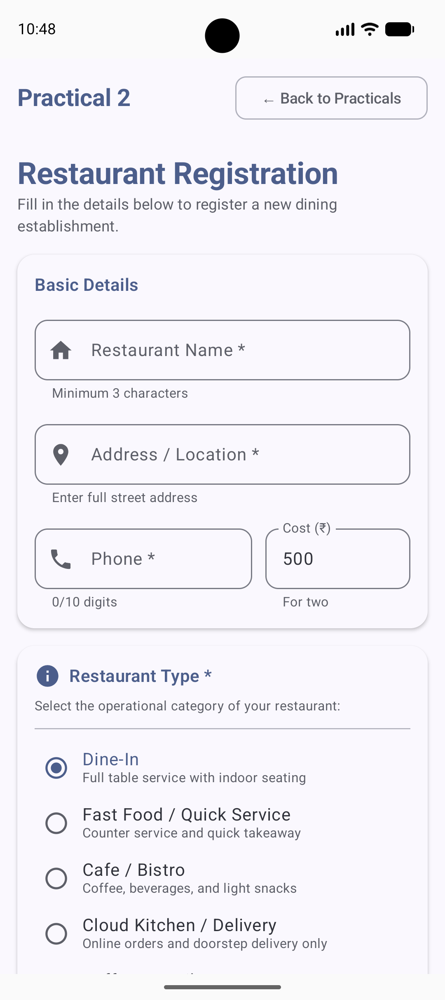
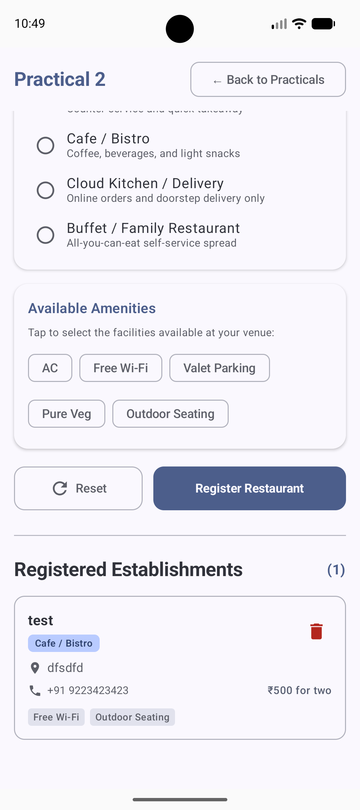

# Practical 2: Restaurant Data Entry Form with Jetpack Compose

> **Course:** Mobile Application Development  
> **Practical:** Practical 2  

---

## 🎯 Practical Objectives

- Construct structured linear layouts using **`Column`** (vertical) and **`Row`** (horizontal) composables.
- Implement text input fields using **`OutlinedTextField`** and explore the maximum available configuration parameters (labels, placeholders, icons, keyboard options, error states, and supporting text).
- Implement a mutually exclusive selection group using **`RadioButton`** to select the type of restaurant, exploring styling and tap-target options.
- Manage user input state and handle UI recomposition using **`remember`** and **`mutableStateOf`**.
- Validate user inputs (such as non-empty text and valid contact numbers) and provide clear visual feedback using error borders and `Toast` messages.
- Practice building modular, self-contained composable functions.
- **🌟 Bonus Task:** Store added restaurants in a reactive list and print/render them dynamically on the screen beneath the form.

> [!NOTE]
> **Design Freedom:** Students are encouraged to customize their own restaurant concept (e.g., Pizzeria, Cafe, Fine Dining, Cloud Kitchen), choose their own fields, color palette, and layout arrangements.

---

## 🏗️ Section 1: Layout Fundamentals (`Column` and `Row`)

In Jetpack Compose, you arrange user interface elements by nesting composable layout functions. Compose does not require legacy XML layout files; your entire UI is written natively in Kotlin.

```
+-------------------------------------------------------------+
| Column (Vertical stacking)                                  |
|                                                             |
|  +-------------------------------------------------------+  |
|  | OutlinedTextField (Restaurant Name)                   |  |
|  +-------------------------------------------------------+  |
|                                                             |
|  +-------------------------------------------------------+  |
|  | Row (Horizontal alignment)                            |  |
|  |  [ OutlinedTextField (Phone) ] [ TextField (Cost) ]   |  |
|  +-------------------------------------------------------+  |
|                                                             |
|  +-------------------------------------------------------+  |
|  | Card (Restaurant Type Selection)                      |  |
|  |   (o) Dine-In    ( ) Takeaway    ( ) Delivery         |  |
|  +-------------------------------------------------------+  |
|                                                             |
|  +-------------------------------------------------------+  |
|  | Row (Action Buttons)                                  |  |
|  |  [ OutlinedButton: Reset ]  [ Button: Submit ]        |  |
|  +-------------------------------------------------------+  |
+-------------------------------------------------------------+
```

### 1.1 Exploring Layout Parameters

Students should explore the full set of parameters available in `Column` and `Row`:

```kotlin
Column(
    modifier = Modifier
        .fillMaxWidth()
        .padding(16.dp),
    verticalArrangement = Arrangement.spacedBy(12.dp), // Automatic spacing between all children
    horizontalAlignment = Alignment.Start              // Alignment of child elements along the horizontal axis
) {
    // Child composables placed here are stacked vertically
}
```

* **`Arrangement.spacedBy(dp)`:** Automatically inserts uniform spacing between consecutive items without requiring manual `Spacer` elements between every row.
* **`Arrangement.SpaceBetween`:** In a `Row`, pushes the first child to the start and the last child to the end.
* **`Alignment.CenterVertically`:** In a `Row`, vertically centers controls of differing heights (e.g., pairing a `RadioButton` with a `Text` label).
* **`Modifier.weight(float)`:** Divides available space proportionally between sibling elements inside a `Row` or `Column`.

---

## 🎛️ Section 2: Input Controls & Composable Parameter Exploration

Students are required to explore and experiment with the maximum available parameters across each input composable.

### 2.1 `OutlinedTextField` Parameter Exploration

`OutlinedTextField` is the Material 3 standard for text inputs. Students should explore the following options:

| Parameter | Type | Purpose & Practical Usage |
| :--- | :--- | :--- |
| `value` | `String` | The current text displayed in the field. |
| `onValueChange` | `(String) -> Unit` | Lambda invoked whenever the user types or deletes characters. |
| `label` | `@Composable () -> Unit` | Floating label that rests on the top border (e.g., `Text("Restaurant Name *")`). |
| `placeholder` | `@Composable () -> Unit` | Hint shown when the text field is empty (e.g., `Text("e.g. Spice Route")`). |
| `leadingIcon` | `@Composable () -> Unit` | Icon displayed at the start of the field (e.g., `Icons.Default.Home` or `Icons.Default.Phone`). |
| `trailingIcon` | `@Composable () -> Unit` | Action icon at the end of the field (e.g., a Clear button). |
| `isError` | `Boolean` | When `true`, highlights borders and labels in the theme's error color. |
| `supportingText` | `@Composable () -> Unit` | Helper text or validation error message displayed directly below the field. |
| `singleLine` | `Boolean` | When `true`, restricts the field to a single horizontal scrollable line. |
| `keyboardOptions` | `KeyboardOptions` | Configures the soft keyboard (e.g., `KeyboardType.Phone`, `KeyboardType.Number`, `ImeAction.Next`, `KeyboardCapitalization.Words`). |
| `shape` | `Shape` | Adjusts corner curvature (e.g., `RoundedCornerShape(12.dp)`). |
| `colors` | `TextFieldColors` | Customizes border, background, and cursor colors via `OutlinedTextFieldDefaults.colors(...)`. |

```kotlin
OutlinedTextField(
    value = restaurantName,
    onValueChange = { restaurantName = it },
    modifier = Modifier.fillMaxWidth(),
    label = { Text("Restaurant Name *") },
    placeholder = { Text("Enter establishment name") },
    leadingIcon = { Icon(imageVector = Icons.Default.Home, contentDescription = null) },
    trailingIcon = {
        if (restaurantName.isNotEmpty()) {
            IconButton(onClick = { restaurantName = "" }) {
                Icon(imageVector = Icons.Default.Clear, contentDescription = "Clear")
            }
        }
    },
    isError = isNameError,
    supportingText = {
        if (isNameError) Text("Name must be at least 3 characters")
    },
    singleLine = true,
    keyboardOptions = KeyboardOptions(
        capitalization = KeyboardCapitalization.Words,
        keyboardType = KeyboardType.Text,
        imeAction = ImeAction.Next
    ),
    shape = RoundedCornerShape(12.dp)
)
```

---

### 2.2 `RadioButton` Parameter Exploration

A `RadioButton` represents a single mutually exclusive choice. To make it touch-friendly and accessible, wrap it with a `Text` label inside a clickable `Row`:

| Parameter | Type | Purpose & Practical Usage |
| :--- | :--- | :--- |
| `selected` | `Boolean` | Whether this radio button is currently chosen. |
| `onClick` | `(() -> Unit)?` | Callback when clicked. Set to `null` when the parent `Row` handles clicking. |
| `colors` | `RadioButtonColors` | Customizes selected and unselected circle colors via `RadioButtonDefaults.colors(...)`. |
| `enabled` | `Boolean` | Controls whether the control is interactive. |

```kotlin
Row(
    modifier = Modifier
        .fillMaxWidth()
        .selectable(
            selected = isSelected,
            onClick = { onSelect(type) },
            role = Role.RadioButton
        )
        .padding(horizontal = 8.dp, vertical = 6.dp),
    verticalAlignment = Alignment.CenterVertically
) {
    RadioButton(
        selected = isSelected,
        onClick = null, // Handled by parent Row for a larger tap target
        colors = RadioButtonDefaults.colors(
            selectedColor = MaterialTheme.colorScheme.primary
        )
    )
    Spacer(modifier = Modifier.width(12.dp))
    Text(text = typeName, style = MaterialTheme.typography.bodyLarge)
}
```

> [!TIP]
> **Mobile Accessibility Tip:**  
> Small radio buttons can be difficult to tap on mobile screens. Using `Modifier.selectable` on the parent `Row` expands the clickable area to the full width of the row.

---

### 2.3 `Button` & `OutlinedButton` Parameter Exploration

Students should explore both filled and outlined buttons:

```kotlin
Row(
    modifier = Modifier.fillMaxWidth(),
    horizontalArrangement = Arrangement.spacedBy(12.dp)
) {
    // Reset Button (Outlined style)
    OutlinedButton(
        onClick = { /* Reset form */ },
        modifier = Modifier.weight(1f),
        shape = RoundedCornerShape(12.dp)
    ) {
        Icon(imageVector = Icons.Default.Refresh, contentDescription = null)
        Spacer(modifier = Modifier.width(6.dp))
        Text("Reset")
    }

    // Submit Button (Filled primary style)
    Button(
        onClick = { /* Validate & Save */ },
        modifier = Modifier.weight(1.5f),
        shape = RoundedCornerShape(12.dp),
        colors = ButtonDefaults.buttonColors(
            containerColor = MaterialTheme.colorScheme.primary
        )
    ) {
        Text("Save Restaurant")
    }
}
```

---

## 🔄 Section 3: Managing State & Recomposition

In Jetpack Compose, the UI is an expression of state. When state changes, Compose automatically re-executes the relevant composable functions (**recomposition**).

```
User Types in TextField ──> onValueChange Triggers ──> State Updates
                                                             │
UI Recomposes with New Value <───────────────────────────────┘
```

### 3.1 Using `remember` and `mutableStateOf`

```kotlin
// Holds a single piece of mutable state across recompositions
var restaurantName by remember { mutableStateOf("") }
var selectedType by remember { mutableStateOf("Dine-In") }
```

* **`mutableStateOf(initialValue)`:** Creates an observable value holder that triggers recomposition when its `.value` changes.
* **`remember { ... }`:** Tells Compose to preserve the value across recompositions so it is not reset back to the initial value on every redraw.

---

## 📝 Section 4: Designing the Restaurant Data Entry Form

Students have the creative freedom to design their form. Below is the recommended structure for the restaurant registration screen:

### 4.1 Recommended Form Sections
1. **Header Section:** Title and a brief subtitle introducing the form.
2. **Basic Information Section:**
   * Restaurant Name (`OutlinedTextField`)
   * Full Address / Location (`OutlinedTextField`)
   * Contact Number (`OutlinedTextField` with `KeyboardType.Phone`)
3. **Restaurant Type Section:**
   * A group of `RadioButton` options representing different categories:
     * *Dine-In*
     * *Fast Food / Takeaway*
     * *Cafe / Bistro*
     * *Cloud Kitchen / Delivery*
     * *Buffet / Family Style*
4. **Additional Details (Student's Choice):**
   * Average Cost for Two (`KeyboardType.Number`)
   * Amenities / Features (e.g., Pure Veg, AC, Free Wi-Fi)
5. **Action Controls:**
   * A **Reset Button** to clear all fields.
   * A **Submit Button** to validate fields and save the record.
6. **Confirmation / Output Display:**
   * Display a `Toast` or summary card showing the registered restaurant details.

---

## 🌟 Section 5: Bonus Task — Dynamically Printing Added Restaurants

To make the application truly interactive, students can maintain a live, reactive list of registered restaurants that prints dynamically on the screen below the form whenever the user taps **Save Restaurant**.

```
+-------------------------------------------------------------+
| Registered Restaurants (2)                                  |
|                                                             |
| +---------------------------------------------------------+ |
| | The Spice Route                       [ Dine-In Badge ] | |
| | Type: Dine-In                                           | |
| | Location: 42 MG Road, Bengaluru                         | |
| | Contact: +91 9876543210                                 | |
| +---------------------------------------------------------+ |
|                                                             |
| +---------------------------------------------------------+ |
| | Chai & Bites                             [ Cafe Badge ] | |
| | Type: Cafe / Bistro                                     | |
| | Location: Indiranagar, Bengaluru                        | |
| | Contact: +91 9123456780                                 | |
| +---------------------------------------------------------+ |
+-------------------------------------------------------------+
```

### 5.1 Step 1: Define a Data Model

Create a data class representing a single restaurant entry:

```kotlin
data class Restaurant(
    val name: String,
    val address: String,
    val phone: String,
    val type: String
)
```

### 5.2 Step 2: Create a Reactive List

Declare a reactive list in your screen composable using `mutableStateListOf`:

```kotlin
// A reactive list that triggers UI recomposition whenever items are added or removed
val registeredRestaurants = remember { mutableStateListOf<Restaurant>() }
```

### 5.3 Step 3: Append to the List on Submit

Inside the Submit button's `onClick` lambda, after successful validation:

```kotlin
val newEntry = Restaurant(
    name = restaurantName,
    address = address,
    phone = phone,
    type = selectedType
)

// Add new restaurant to the top of the list
registeredRestaurants.add(0, newEntry)

// Clear input fields
restaurantName = ""
address = ""
phone = ""
```

### 5.4 Step 4: Render the List Dynamically (with Delete Button)

Below the action buttons, iterate over `registeredRestaurants` and display each entry using `OutlinedCard`. Include an **`IconButton` with a Delete icon** so users can remove items from the reactive list:

```kotlin
Text(
    text = "Registered Establishments (${registeredRestaurants.size})",
    style = MaterialTheme.typography.titleLarge,
    fontWeight = FontWeight.Bold
)

if (registeredRestaurants.isEmpty()) {
    Text(
        text = "No restaurants added yet. Fill out the form above to add one.",
        style = MaterialTheme.typography.bodyMedium,
        color = MaterialTheme.colorScheme.onSurfaceVariant
    )
} else {
    registeredRestaurants.forEach { restaurant ->
        OutlinedCard(
            modifier = Modifier
                .fillMaxWidth()
                .padding(vertical = 4.dp),
            shape = RoundedCornerShape(12.dp)
        ) {
            Column(modifier = Modifier.padding(16.dp)) {
                // Header Row: Restaurant Name and Delete Button
                Row(
                    modifier = Modifier.fillMaxWidth(),
                    horizontalArrangement = Arrangement.SpaceBetween,
                    verticalAlignment = Alignment.CenterVertically
                ) {
                    Text(
                        text = restaurant.name,
                        style = MaterialTheme.typography.titleMedium,
                        fontWeight = FontWeight.Bold
                    )

                    // Delete Button: Removes item from the reactive list
                    IconButton(
                        onClick = {
                            registeredRestaurants.remove(restaurant)
                        }
                    ) {
                        Icon(
                            imageVector = Icons.Default.Delete,
                            contentDescription = "Delete ${restaurant.name}",
                            tint = MaterialTheme.colorScheme.error
                        )
                    }
                }

                Text(text = "Category: ${restaurant.type}", color = MaterialTheme.colorScheme.primary)
                Text(text = "Address: ${restaurant.address}")
                Text(text = "Contact: +91 ${restaurant.phone}")
            }
        }
    }
}
```

> [!TIP]
> **How Deletion Works in Compose:**  
> When `registeredRestaurants.remove(restaurant)` is called, the reactive `SnapshotStateList` notifies Compose of the change. Compose automatically recomposes only the affected UI elements, smoothly removing the card from the screen without needing any manual list refresh.

---

## 🧪 Section 6: Running the Form & Verification Checkpoint

Follow these steps to run and verify your form:

1. **Verify Active Device:** Confirm your emulator (e.g. `Pixel 8`) is running.
2. **Run App:** Click the green **Run (▶)** button in the top toolbar.
3. **Open Practical 2 Screen:** Tap the **"Practical 2: Restaurant Data Entry Form"** button on the home menu screen (you can tap **"← Back to Practicals"** anytime to return).

| Form Inputs & Radio Selection | Amenities, Actions & Live Ledger |
| :---: | :---: |
|  |  |

> [!NOTE]
> **Connecting to Practical 1's Dashboard:**  
> In Practical 1 (Session 2), you built the dashboard menu in `MainActivity.kt` with buttons for Practical 1 and Practical 2. For this practical, connect your completed `RestaurantFormScreen()` to the Practical 2 button in `MainActivity.kt` to replace the initial placeholder text with your full restaurant form.

### 📋 Student Verification Checklist

Before completing this practical, verify that:
- [ ] Your form is organized cleanly using `Column` and `Row` layouts.
- [ ] `OutlinedTextField` uses labels, placeholders, leading icons, and appropriate keyboard types.
- [ ] Radio buttons allow selecting only one restaurant type at a time (mutually exclusive).
- [ ] The Reset button clears all fields back to their defaults.
- [ ] The Submit button validates required inputs (e.g., non-empty name, 10-digit phone) and displays a confirmation message.
- [ ] *(Bonus Task)* Added restaurants are stored in a reactive list, displayed dynamically on the screen below the form, and can be deleted using the Delete button.

---

## 📁 Reference Code in This Repository

Students can explore the complete reference implementation built inside project `p1`:

* **Main App & Dashboard Navigation:** [`p1/app/src/main/java/com/example/p1/MainActivity.kt`](./p1/app/src/main/java/com/example/p1/MainActivity.kt)
* **Primary Form Screen:** [`p1/app/src/main/java/com/example/p1/practical2/ui/RestaurantFormScreen.kt`](./p1/app/src/main/java/com/example/p1/practical2/ui/RestaurantFormScreen.kt)
* **Radio Button Selection Group:** [`p1/app/src/main/java/com/example/p1/practical2/ui/RestaurantRadioGroup.kt`](./p1/app/src/main/java/com/example/p1/practical2/ui/RestaurantRadioGroup.kt)
* **Restaurant Record Card & Delete Button:** [`p1/app/src/main/java/com/example/p1/practical2/ui/RestaurantRecordCard.kt`](./p1/app/src/main/java/com/example/p1/practical2/ui/RestaurantRecordCard.kt)
* **Form State & Validation Logic:** [`p1/app/src/main/java/com/example/p1/practical2/model/RestaurantFormState.kt`](./p1/app/src/main/java/com/example/p1/practical2/model/RestaurantFormState.kt)
* **Domain Model & Enums:** [`p1/app/src/main/java/com/example/p1/practical2/model/Restaurant.kt`](./p1/app/src/main/java/com/example/p1/practical2/model/Restaurant.kt)

---

## 🌐 Helpful Resources

- **[Material 3 Design System (`m3.material.io`)](https://m3.material.io/):** Component catalogs, elevation tokens, color roles, and design guidelines for `OutlinedTextField`, `RadioButton`, `Card`, and `Button`.
- **[Compose Material 3 Developer Guide](https://developer.android.com/develop/ui/compose/designsystems/material3):** Official Android documentation for implementing Material 3 components in Jetpack Compose.
