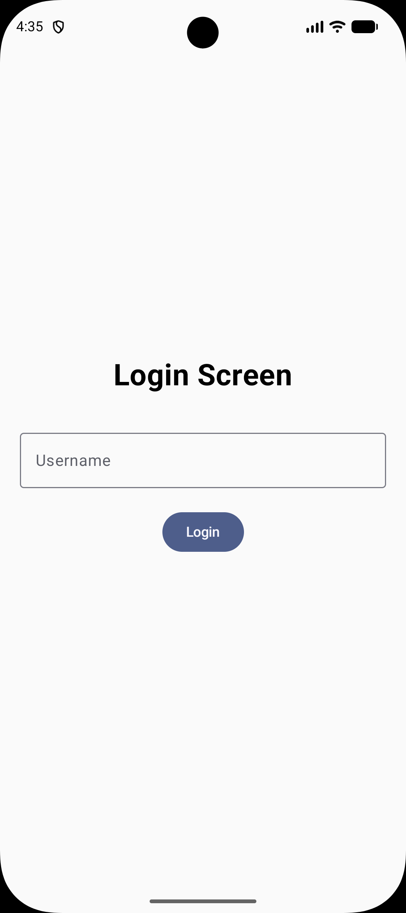
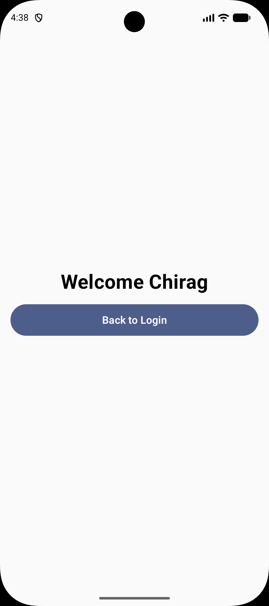

# Practical 3: Production-Level Type-Safe Navigation in Jetpack Compose

> **Course:** Mobile Application Development  
> **Practical:** Practical 3  
> **Topic:** Type-Safe Navigation Architecture with Jetpack Compose & Kotlinx Serialization  

---

## 🎯 Practical Objectives

- Understand the evolution of navigation in Jetpack Compose from error-prone String routes to modern **Type-Safe Routes**.
- Configure project and module Gradle build scripts with **`kotlinx.serialization`** and **`androidx.navigation:navigation-compose`**.
- Model app destinations using a **`@Serializable sealed class`** hierarchy supporting both argument-free routes and argument-bearing routes.
- Build modular, decoupled screen composables (`Login`, `Home`, and `Welcome`) using **State Hoisting** and navigation callback events.
- Construct a centralized **`NavHost`** controller managing destination graphs, route mapping, and argument extraction via `toRoute<T>()`.
- Implement production-level back stack management techniques (e.g., `popUpTo`, `inclusive = true`, and `launchSingleTop`).
- Run, test, and debug multi-screen navigation flows on an Android Virtual Device (AVD).

---

## 🧭 Section 1: Navigation Architecture Overview

Navigating between screens in modern Android applications with Jetpack Compose differs fundamentally from legacy Activity/Fragment transactions. Jetpack Compose applications are typically **Single-Activity Applications** where screens are composable functions swapped reactively inside a **`NavHost`**.

| Login Screen (Start Destination) | Welcome Screen (Typed Argument Received) |
| :---: | :---: |
|  |  |


```
+-----------------------------------------------------------------------------------+
|                                MainActivity.kt                                    |
|                                                                                   |
|   +---------------------------------------------------------------------------+   |
|   |                              NavGraph.kt                                  |   |
|   |                                                                           |   |
|   |   +-------------------+    navController.navigate()    +--------------+   |   |
|   |   |   Login Screen    | ─────────────────────────────> |  Home Screen |   |   |
|   |   +-------------------+                                +--------------+   |   |
|   |             │                                                             |   |
|   |             │ NavRoutes.Welcome(userName)                                 |   |
|   |             ▼                                                             |   |
|   |   +-------------------+                                                   |   |
|   |   |  Welcome Screen   | (Extracts userName via toRoute<NavRoutes.Welcome>) |   |
|   |   +-------------------+                                                   |   |
|   +---------------------------------------------------------------------------+   |
+-----------------------------------------------------------------------------------+
```

### 1.1 Why Modern Type-Safe Navigation?

Historically (Navigation Compose prior to version 2.8.0), routes were defined as URL-like Strings:
```kotlin
// ❌ Legacy String-based Navigation (Prone to runtime crashes, typos, manual parsing)
navController.navigate("welcome/" + userName)
composable("welcome/{userName}") { backStackEntry ->
    val user = backStackEntry.arguments?.getString("userName") // Unchecked string key
}
```

Starting with **Navigation Compose 2.8+**, Google introduced official **Type-Safe Navigation** powered by **Kotlinx Serialization**:
- **Compile-Time Safety:** Typos in route names fail at compile time instead of causing runtime crashes.
- **Automatic Type Conversion:** Integers, booleans, and custom models are passed with full type safety without manual bundle parsing.
- **Refactoring Friendly:** Renaming a route or argument updates all call sites through standard IDE refactoring tools.

> 📖 **Official Documentation:** Refer to Google's official guide on [Android Jetpack Navigation Compose](https://developer.android.com/guide/navigation).

---

## 📦 Section 2: Step 1 — Configuring Dependencies

To enable Kotlinx Serialization and Navigation Compose, add the following configurations to your project.

### 2.1 Project-Level Gradle Configuration (`build.gradle.kts`)

Open the root `build.gradle.kts` file and declare the Kotlin Serialization plugin:

```kotlin
// Project: root build.gradle.kts
plugins {
    alias(libs.plugins.android.application) apply false
    alias(libs.plugins.kotlin.compose) apply false

    // Kotlin serialization plugin (align with your Kotlin compiler version)
    kotlin("jvm") version "2.2.0" 
    kotlin("plugin.serialization") version "2.2.0" 
}
```

### 2.2 Module-Level Gradle Configuration (`app/build.gradle.kts`)

Open your app module `app/build.gradle.kts` and apply the plugin, then add the navigation and serialization dependencies:

```kotlin
// Module: app/build.gradle.kts
plugins {
    alias(libs.plugins.android.application)
    alias(libs.plugins.kotlin.compose)

    // 1. Apply Kotlinx Serialization Plugin
    id("org.jetbrains.kotlin.plugin.serialization") version "2.2.0"
}

dependencies {
    // Standard Compose Dependencies...
    implementation(platform(libs.androidx.compose.bom))
    implementation(libs.androidx.compose.material3)
    implementation(libs.androidx.compose.ui)

    // 2. Navigation Compose (Version 2.8.0+ for Type Safety support)
    implementation("androidx.navigation:navigation-compose:2.10.2")

    // 3. Kotlinx Serialization JSON
    implementation("org.jetbrains.kotlinx:kotlinx-serialization-json:1.9.0")
}
```

> [!IMPORTANT]
> Always perform a **Gradle Sync** (`File > Sync Project with Gradle Files`) after editing build scripts. Ensure no network proxy or version mismatch errors occur before proceeding.

---

## 🗺️ Section 3: Step 2 — Defining Type-Safe Routes (`NavRoutes.kt`)

Create a dedicated file `NavRoutes.kt` inside your navigation package:  
`com.paytm.mobileApp.theory.navigation.NavRoutes.kt`

A Kotlin **`sealed class`** or **`sealed interface`** provides a restricted hierarchy where all subclasses are known at compile time:
- Use **`object`** for routes that do not accept parameters (e.g., `Home`, `Login`).
- Use **`data class`** for routes that accept parameters (e.g., `Welcome` taking `userName`).

```kotlin
package com.paytm.mobileApp.theory.navigation

import kotlinx.serialization.Serializable

// Official Reference: https://developer.android.com/guide/navigation#kts

/**
 * Step 2: Create Serializable Routes
 * Sealed class creates a restricted hierarchy (subclasses must be defined in this file).
 * Each subclass represents a distinct screen destination in the application.
 */
@Serializable
sealed class NavRoutes {

    // Argument-free destinations use object instances
    @Serializable
    object Login : NavRoutes()

    @Serializable
    object Home : NavRoutes()

    // Destinations requiring arguments use data classes
    @Serializable
    data class Welcome(val userName: String) : NavRoutes()
}
```

### 💡 Why `@Serializable` on every child?
The Navigation Compose compiler plugin inspects each route class at compile-time to automatically generate serializers and bundle marshalling logic.

---

## 📱 Section 4: Step 3 — Designing Screen Composables

Create three independent screen files inside the `screens` package:  
`com/paytm/mobileApp/theory/navigation/screens/`

### 4.1 Production Design Pattern: State Hoisting & Decoupling

> Best Practice: 
> Before connecting screens to the navigation system, build them as self-contained composables. In professional Android development, screen composables should **not** directly depend on `NavHostController` whenever possible. Passing callbacks (e.g., `onNavigateToHome: () -> Unit`) enables:
> 1. Easy rendering in **`@Preview`** without mocking `NavHostController`.
> 2. High reusability and unit testability.
> 3. Clear separation between UI layout and routing logic.

Below are the screen implementations demonstrating clean UI layout and action triggers:

---

### 4.2 Login Screen (`Login.kt`)

`screens/Login.kt` accepts username input, validates it, and triggers navigation events:

```kotlin
package com.paytm.mobileApp.theory.navigation.screens

import androidx.compose.foundation.layout.Arrangement
import androidx.compose.foundation.layout.Column
import androidx.compose.foundation.layout.Spacer
import androidx.compose.foundation.layout.fillMaxSize
import androidx.compose.foundation.layout.fillMaxWidth
import androidx.compose.foundation.layout.height
import androidx.compose.foundation.layout.padding
import androidx.compose.material3.Button
import androidx.compose.material3.OutlinedTextField
import androidx.compose.material3.Text
import androidx.compose.runtime.Composable
import androidx.compose.runtime.getValue
import androidx.compose.runtime.mutableStateOf
import androidx.compose.runtime.remember
import androidx.compose.runtime.setValue
import androidx.compose.ui.Alignment
import androidx.compose.ui.Modifier
import androidx.compose.ui.text.font.FontWeight
import androidx.compose.ui.unit.dp
import androidx.compose.ui.unit.sp
import androidx.navigation.NavHostController
import com.paytm.mobileApp.theory.navigation.NavRoutes

@Composable
fun Login(navController: NavHostController) {
    var userName by remember { mutableStateOf("") }

    Column(
        modifier = Modifier
            .fillMaxSize()
            .padding(24.dp),
        horizontalAlignment = Alignment.CenterHorizontally,
        verticalArrangement = Arrangement.Center
    ) {
        Text(
            text = "Login Screen",
            fontWeight = FontWeight.Bold,
            fontSize = 30.sp
        )

        Spacer(modifier = Modifier.height(16.dp))

        OutlinedTextField(
            value = userName,
            onValueChange = { userName = it },
            label = { Text("Username") },
            placeholder = { Text("Enter your name") },
            singleLine = true,
            modifier = Modifier.fillMaxWidth()
        )

        Spacer(modifier = Modifier.height(16.dp))

        Button(
            onClick = {
                if (userName.isNotBlank()) {
                    // Navigate to Welcome screen, passing userName as typed argument
                    navController.navigate(NavRoutes.Welcome(userName = userName))
                }
            },
            modifier = Modifier.fillMaxWidth().height(48.dp)
        ) {
            Text(text = "Login", fontSize = 16.sp)
        }
    }
}
```

---

### 4.3 Home Screen (`Home.kt`)

`screens/Home.kt` displays a dashboard placeholder with a button to return or switch destinations:

```kotlin
package com.paytm.mobileApp.theory.navigation.screens

import androidx.compose.foundation.layout.Arrangement
import androidx.compose.foundation.layout.Column
import androidx.compose.foundation.layout.Spacer
import androidx.compose.foundation.layout.fillMaxSize
import androidx.compose.foundation.layout.fillMaxWidth
import androidx.compose.foundation.layout.height
import androidx.compose.foundation.layout.padding
import androidx.compose.material3.Button
import androidx.compose.material3.Text
import androidx.compose.runtime.Composable
import androidx.compose.ui.Alignment
import androidx.compose.ui.Modifier
import androidx.compose.ui.text.font.FontWeight
import androidx.compose.ui.unit.dp
import androidx.compose.ui.unit.sp
import androidx.navigation.NavHostController
import com.paytm.mobileApp.theory.navigation.NavRoutes

@Composable
fun Home(navController: NavHostController) {
    Column(
        modifier = Modifier
            .fillMaxSize()
            .padding(horizontal = 24.dp),
        horizontalAlignment = Alignment.CenterHorizontally,
        verticalArrangement = Arrangement.Center
    ) {
        Text(
            text = "Home Screen",
            fontSize = 30.sp,
            fontWeight = FontWeight.Bold
        )

        Spacer(modifier = Modifier.height(16.dp))

        Button(
            onClick = {
                navController.navigate(NavRoutes.Login)
            },
            modifier = Modifier
                .fillMaxWidth()
                .height(48.dp)
        ) {
            Text(
                text = "Back to Login",
                fontSize = 16.sp,
                fontWeight = FontWeight.SemiBold
            )
        }
    }
}
```

---

### 4.4 Welcome Screen (`Welcome.kt`)

`screens/Welcome.kt` displays the dynamic username passed during navigation:

```kotlin
package com.paytm.mobileApp.theory.navigation.screens

import androidx.compose.foundation.layout.Arrangement
import androidx.compose.foundation.layout.Column
import androidx.compose.foundation.layout.Spacer
import androidx.compose.foundation.layout.fillMaxSize
import androidx.compose.foundation.layout.fillMaxWidth
import androidx.compose.foundation.layout.height
import androidx.compose.foundation.layout.padding
import androidx.compose.material3.Button
import androidx.compose.material3.Text
import androidx.compose.runtime.Composable
import androidx.compose.ui.Alignment
import androidx.compose.ui.Modifier
import androidx.compose.ui.text.font.FontWeight
import androidx.compose.ui.unit.dp
import androidx.compose.ui.unit.sp
import androidx.navigation.NavHostController
import com.paytm.mobileApp.theory.navigation.NavRoutes

@Composable
fun Welcome(userName: String, navController: NavHostController) {
    Column(
        modifier = Modifier
            .fillMaxSize()
            .padding(horizontal = 24.dp),
        horizontalAlignment = Alignment.CenterHorizontally,
        verticalArrangement = Arrangement.Center
    ) {
        Text(
            text = "Welcome $userName! 🎉",
            fontSize = 28.sp,
            fontWeight = FontWeight.Bold
        )

        Spacer(modifier = Modifier.height(16.dp))

        Button(
            onClick = {
                navController.navigate(NavRoutes.Home)
            },
            modifier = Modifier
                .fillMaxWidth()
                .height(48.dp)
        ) {
            Text(
                text = "Proceed to Home",
                fontSize = 16.sp,
                fontWeight = FontWeight.SemiBold
            )
        }
    }
}
```

---

## 🕸️ Section 5: Step 4 — Assembling the Navigation Graph (`NavGraph.kt`)

Create `NavGraph.kt` in `com.paytm.mobileApp.theory.navigation`:

The **`NavHost`** links the `navController` with destination destinations using generic `composable<T>()` blocks.

```kotlin
package com.paytm.mobileApp.theory.navigation

import androidx.compose.runtime.Composable
import androidx.navigation.compose.NavHost
import androidx.navigation.compose.composable
import androidx.navigation.compose.rememberNavController
import androidx.navigation.toRoute
import com.paytm.mobileApp.theory.navigation.screens.Home
import com.paytm.mobileApp.theory.navigation.screens.Login
import com.paytm.mobileApp.theory.navigation.screens.Welcome

@Composable
fun NavGraph() {
    // 1. rememberNavController: Creates and survives recomposition
    val navController = rememberNavController()

    // 2. NavHost container with start destination
    NavHost(
        navController = navController,
        startDestination = NavRoutes.Login
    ) {
        // Destination 1: Login Route
        composable<NavRoutes.Login> {
            Login(navController = navController)
        }

        // Destination 2: Home Route
        composable<NavRoutes.Home> {
            Home(navController = navController)
        }

        // Destination 3: Welcome Route with argument deserialization
        // backStackEntry contains the passed arguments bundle
        composable<NavRoutes.Welcome> { backStackEntry ->
            // toRoute<T>() automatically deserializes arguments into NavRoutes.Welcome
            val routeData = backStackEntry.toRoute<NavRoutes.Welcome>()
            Welcome(userName = routeData.userName, navController = navController)
        }
    }
}
```

### 5.1 How `toRoute<T>()` Works Behind the Scenes
When `navController.navigate(NavRoutes.Welcome(userName = "Alice"))` is executed:
1. Navigation Compose serializes the `NavRoutes.Welcome` object into an internal `NavBackStackEntry` bundle.
2. The `composable<NavRoutes.Welcome>` matcher identifies the destination.
3. `backStackEntry.toRoute<NavRoutes.Welcome>()` reconstructs the strongly-typed data class instance without manual string key extraction.

---

## 🚀 Section 6: Production-Grade Navigation Best Practices

To make navigation truly production-ready, you must understand back stack manipulation:

### 6.1 Back Stack Cleanup with `popUpTo`
In authentication flows, after a user logs in, pressing the hardware/gesture **Back** button should **not** return them to the Login screen. It should either exit the app or stay on Home.

```kotlin
// Production Login Navigation: Clears Login from the Back Stack
navController.navigate(NavRoutes.Home) {
    popUpTo<NavRoutes.Login> {
        inclusive = true // Removes Login screen completely from the back stack
    }
    launchSingleTop = true // Prevents duplicate instances if tapped multiple times
}
```

### 6.2 Comparison: Direct NavController vs Callback Hoisting

| Feature | Passing `NavController` to Screens | State Hoisting with Callbacks |
| :--- | :--- | :--- |
| **Coupling** | Tightly coupled to Navigation Compose | 100% pure UI composable |
| **Compose Previews** | Fails or requires dummy NavController mocks | Works seamlessly out of the box |
| **Testing** | Requires test NavHost setup | Standard UI component test |
| **Industry Usage** | Small prototypes / quick demos | Production-grade Android applications |

#### Callback Hoisting Example:
```kotlin
// Screen definition (Pure UI)
@Composable
fun LoginScreen(onLoginSuccess: (String) -> Unit) {
    var name by remember { mutableStateOf("") }
    Button(onClick = { onLoginSuccess(name) }) { Text("Login") }
}

// In NavGraph.kt (Routing Logic)
composable<NavRoutes.Login> {
    LoginScreen(onLoginSuccess = { user ->
        navController.navigate(NavRoutes.Welcome(user))
    })
}
```

---

## 🌟 Section 7: Hands-On Lab Challenges


### Challenge 1: Backstack Prevention on Logout & Login 
- Update `Login.kt` so that navigating to `Welcome` or `Home` clears `NavRoutes.Login` from the back stack using `popUpTo<NavRoutes.Login> { inclusive = true }`.
- Add a "Logout" button on `Home.kt` that navigates back to `Login` and clears `Home` from the back stack.

### Challenge 2: Multi-Argument Screen Destination
- Extend `NavRoutes.kt` with a new route:
  ```kotlin
  @Serializable
  data class Profile(val userId: Int, val email: String, val isVerified: Boolean) : NavRoutes()
  ```
- Build `ProfileScreen.kt` displaying all three fields.
- Wire this route in `NavGraph.kt` and navigate to it from `Home.kt`.

### Challenge 3: Input Validation & Error Handling 
- Ensure the Login button in `Login.kt` displays an error message (using `supportingText` and `isError` on `OutlinedTextField`) if the username contains fewer than 3 characters or contains invalid symbols.

---

## 🧪 Section 8: Verification Checkpoint & Checklist

1. **Host Connection:** In `MainActivity.kt`, verify `NavGraph()` is invoked within the theme wrapper:
   ```kotlin
   setContent {
       PaytmTheme {
           NavGraph()
       }
   }
   ```
2. **Launch App:** Run the app on an Android Virtual Device (AVD).
3. **Verify Route Flow:**
   - App opens on `Login Screen`.
   - Entering `"Alex"` and clicking **Login** opens `Welcome Screen` displaying `"Welcome Alex! 🎉"`.
   - Clicking **Proceed to Home** transitions to `Home Screen`.
   - Verify hardware back navigation behaves as expected.

### 📋 Student Verification Checklist
- [ ] Added `kotlinx.serialization` plugin in both project and module `build.gradle.kts`.
- [ ] Added `navigation-compose:2.10.2` and `kotlinx-serialization-json:1.9.0` dependencies.
- [ ] Created `NavRoutes.kt` with `@Serializable sealed class` containing `Login`, `Home`, and `Welcome(userName)`.
- [ ] Built independent composables `Login.kt`, `Home.kt`, and `Welcome.kt` inside `screens/`.
- [ ] Configured `NavHost` inside `NavGraph.kt` using `composable<T>` and `toRoute<T>()`.
- [ ] Successfully passed and rendered typed argument (`userName`) on the `Welcome` screen.
- [ ] *(Bonus)* Implemented `popUpTo` back stack clearing so the back button does not return to Login after authentication.

---

## 📁 Reference Code in This Repository

- **Navigation Routes:** [`Paytm/.../theory/navigation/NavRoutes.kt`](./Paytm/app/src/main/java/com/paytm/mobileApp/theory/navigation/NavRoutes.kt)
- **Navigation Graph Host:** [`Paytm/.../theory/navigation/NavGraph.kt`](./Paytm/app/src/main/java/com/paytm/mobileApp/theory/navigation/NavGraph.kt)
- **Screens Package:** [`Paytm/.../theory/navigation/screens/`](./Paytm/app/src/main/java/com/paytm/mobileApp/theory/navigation/screens/)
  - [`Login.kt`](./Paytm/app/src/main/java/com/paytm/mobileApp/theory/navigation/screens/Login.kt)
  - [`Home.kt`](./Paytm/app/src/main/java/com/paytm/mobileApp/theory/navigation/screens/Home.kt)
  - [`Welcome.kt`](./Paytm/app/src/main/java/com/paytm/mobileApp/theory/navigation/screens/Welcome.kt)
- **App Entry Point:** [`Paytm/.../MainActivity.kt`](./Paytm/app/src/main/java/com/paytm/mobileApp/MainActivity.kt)

---

## 🌐 Helpful Resources

- 📖 **[Android Developers: Jetpack Navigation Guide](https://developer.android.com/guide/navigation)**
- ⚡ **[Type-Safe Navigation in Compose 2.8+](https://developer.android.com/guide/navigation/design#type-safety)**
- 🛠️ **[Kotlinx Serialization Guide](https://github.com/Kotlin/kotlinx.serialization)**
